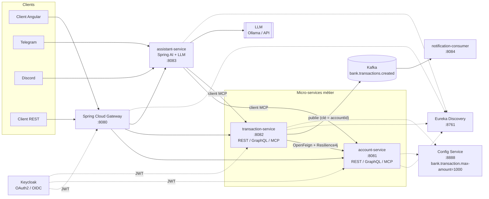
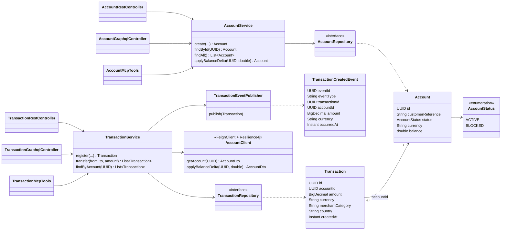
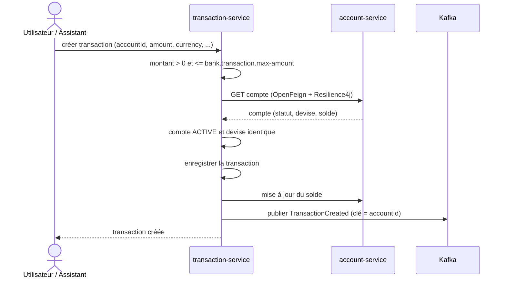

# Conception et architecture (Partie B)

Les diagrammes sont écrits en [Mermaid](https://mermaid.js.org/) : GitHub les affiche directement dans ce fichier.

## 1. Schéma d'architecture



Composants métier : `account-service` et `transaction-service`.
Composants techniques : `config-service`, `discovery-service`, `gateway-service`, `assistant-service`, `notification-consumer`.

## 2. Diagramme de classes



Règle de séparation des couches : les contrôleurs REST, GraphQL et MCP n'appellent que la couche `service`.

## 3. Organisation en couches de chaque micro-service

```
src/main/java/ma/adria/bank/<service>/
├── domain/          entités et types métier
├── repository/      accès aux données (Spring Data)
├── service/         logique métier (unique point d'entrée des connecteurs)
├── web/rest/        contrôleurs REST
├── web/graphql/     contrôleurs GraphQL
└── mcp/             outils MCP exposés à l'assistant
```

## 4. Enregistrement d'une transaction



Un virement est un enchaînement débit du compte source / crédit du compte destination, réalisé par `transaction-service` avec les mêmes contrôles, chaque jambe produisant une transaction et un évènement.

## 5. Choix techniques

| Sujet | Choix | Justification |
|---|---|---|
| Socle | Java 21, Spring Boot 3.5, Spring Cloud 2025.0, Spring AI 1.0 | Versions alignées avec les technologies imposées |
| Persistance | H2 (fichier/mémoire) | Épreuve de 3 h : pas de dépendance d'infrastructure supplémentaire |
| Montant | `BigDecimal` pour les transactions, `double` pour le solde | Respect du modèle minimal imposé |
| Sécurité | Keycloak (OIDC), services en resource server JWT | Authentification centralisée, autorisations par rôle |
| LLM | Ollama en local (configurable) | Pas de clé API à stocker dans le dépôt |
